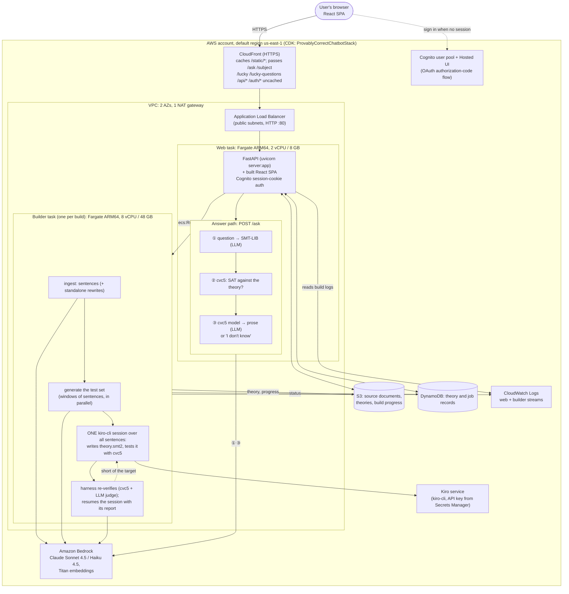
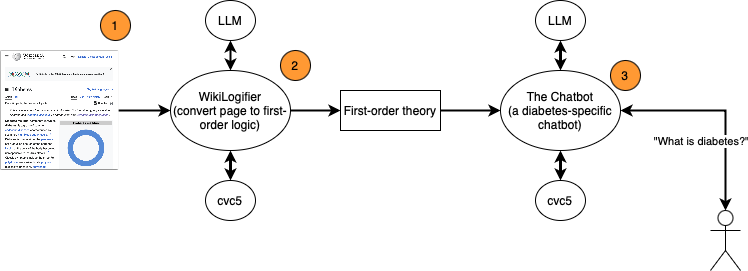
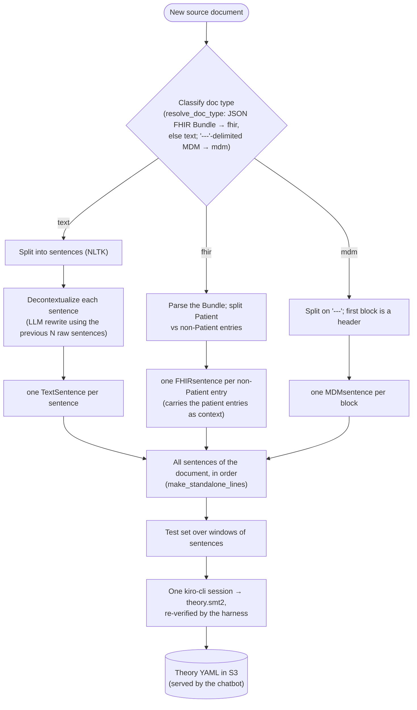

# Provably-correct chatbot using first-order logic

A roadblock to the broad adoption of Generative AI applications (hereafter, “chatbots”) is their confabulatory ways. This is particularly true in domains like healthcare where lives are on the line. This repository shows how to build a chatbot whose responses are provably correct.

You give it a document: a Wikipedia page, pasted prose, or an HL7 FHIR patient record. It turns the **whole document** into one first-order theory in a single unit of work, a [kiro-cli](https://kiro.dev/cli/) agent session that writes the theory and tests it like a program. It then answers questions about the document only when the [cvc5](https://cvc5.github.io/) theorem prover can prove the answer from that theory, and otherwise says “I don’t know”.

## Background

GenAI chatbots have already shown promise in many areas. In healthcare, for example, they both save time and democratize access to specialized biomedical resources. In many domains like healthcare, accuracy is critical. For example, if a clinical application says that “Patient X’s most recent blood pressure was 300/80” and this is not true, then providers and patients will rightly not trust it and, equally rightly, will not use it.

## Problem

Unfortunately, state-of-the-art large language models (LLMs) and large multimodal models (LMMs), while showing a masterful display of the syntax of natural languages, still insist on confabulating and reasoning incorrectly. Despite the industry’s reliance on the now-discredited [scaling laws](https://arxiv.org/pdf/2001.08361), and despite the fact that today’s models are more powerful and capable than models of even 6 months ago, the latest models still consistently confabulate (and, on some metrics, they confabulate [worse](https://www.nytimes.com/2025/05/05/technology/ai-hallucinations-chatgpt-google.html) than older models).

For users to trust Generative AI chatbots, they must trust that these applications are accurate. The industry’s current reliance on scaling laws (i.e., using the same technology but using more parameters, training for longer, and on more data) has not yet provided us a reliable path towards trustworthy systems with fewer confabulations and reasoning errors.

## Opportunity

I here demonstrate a solution that removes confabulations[^1] by using a theorem prover to prove that the chatbot’s responses are correct. Consider a chatbot that is an expert in diabetes:

```
Human: What health complications can diabetes lead to if left untreated?
AI: If left untreated, diabetes can lead to disorders of the cardiovascular system, eye, kidney, and nerves.
Human: How many deaths does diabetes account for annually?
AI: Diabetes accounts for approximately 4.2 million deaths every year.
```

For each of these responses from the chatbot (“AI: …”), the PoC in this project can logically verify that these statements are correct. If one of these answers weren’t provably correct, it would have answered “I don’t know”.

Before describing how this project works, I will first set some context by introducing formal logics and then Neuro-symbolic AI, and finally show how they can together improve the accuracy of a chatbot.

[^1]: There are some minor exceptions, due to the translation to/from natural language and first-order logic; see [FAQ2](#faq2-will-this-solution-confabulate).

## Formal logic

Formal logic is a systematic method of reasoning that uses symbolic or formal languages (languages that focus on form or syntax over function) to represent and analyze arguments, propositions, and inferences. It focuses on the structure (form) of logical arguments rather than their semantics, allowing for rigorous evaluation of validity and soundness. Formal logic uses precise symbols and rules to represent logical relationships, such as implication (⇒),universal quantification (∀),existential quantification (∃), conjunction (∧), disjunction (∨), and negation (¬).

Consider the following well-known example:
```
(∀ X (⇒ (human X) (mortal X)))
(human Socrates)
```

These two well-formed formulas (WFFs) together are called a theory. Given this theory, a theorem prover can deduce that `(mortal Socrates)` is correct (or, _valid_, _satisfiable_) and that `(not (mortal Socrates))` is false (or, _invalid_, _unsatisfiable_).
Compared to ad-hoc reasoning systems, formal logics have the advantage of being well-studied and known to potentially be sound (all deductions are valid) and complete (all valid deductions are provable). For the theoretical limits of formal deduction, see [Gödel's incompleteness theorems](https://en.wikipedia.org/wiki/Gödel%27s_incompleteness_theorems); while interesting, these limits are not a practical concern. 

## Neuro-symbolic AI

[Neuro-symbolic AI](https://en.wikipedia.org/wiki/Neuro-symbolic_AI) combines the strengths of neural networks (their understanding of the syntax of natural language) and the strengths of symbolic reasoners (their understanding of the world and ability to reason about it). This hybrid approach addresses key limitations of both pure neural and pure symbolic systems: neural networks lack interpretability and struggle with reasoning, while symbolic systems can be brittle and don’t understand natural language.

By integrating these approaches, neuro-symbolic AI can achieve more robust reasoning, better generalization, and more transparent decision-making. For example, a neuro-symbolic system might use neural networks to process raw sensory input but then apply symbolic logic to reason about the relationships between recognized objects, like how humans combine pattern recognition with abstract thought.

## Cvc5

I use an open-source [first-order](https://en.wikipedia.org/wiki/First-order_logic) theorem prover, [cvc5](https://cvc5.github.io/). To understand why I currently use cvc5 and not [Bedrock Guardrails Automated Reasoning (AR) checks](https://docs.aws.amazon.com/bedrock/latest/userguide/guardrails-automated-reasoning-checks.html) see [FAQ1](#faq1-why-did-i-not-use-bedrock-guardrails-automated-reasoning-ar-checks).

## Assumptions

Before introducing the solution, it is helpful to understand the assumptions that it is based on:

**Assumption #1**: LLMs are excellent at generating and understanding natural language.

**Assumption #2**: LLMs are also excellent at generating and understanding code.

**Assumption #3**:	LLMs are not good at factuality (they confabulate) and their reasoning is faulty.

**Assumption #4**:	Theorem provers are excellent at provably correct logical deductions.

**Assumption #5**:	Theorem provers are not good at generating and understanding natural language.

**Assumption #6**:	Theorem provers are fickle and difficult to use.

The goal here is to build a _reliable_ system (an accurate chatbot) from a collection of _unreliable_ components (LLMs that confabulate, theorem provers whose outputs are difficult to predict). I now show how to do that.

## The solution

The chatbot is an expert in one document. It has two main components:

1.	The **formalizer** computes a first-order logic representation (a theory) of the whole document in one unit of work (see [Appendix C](#appendix-c-functional-architecture-of-the-formalizer)).
2.	Given this first-order theory (#1), the **chatbot** answers a user’s question as follows:

    2.1.	An LLM converts the user’s natural language question into first-order logic.

    2.2.	The theorem prover determines the satisfiability of #2.1 in the context of the theory (#1).

    2.3.	If #2.2 is satisfiable (there is a provably correct answer to the question) then an LLM translates the theorem prover’s answer back into natural language. If #2.2 is not satisfiable then the chatbot answers “I don’t know”.

The web app lets you add documents, watch each build in its **Job Details** tab, and chat with any theory that is ready in a **Chat** tab of its own. For how each kind of source document (prose, an HL7 FHIR bundle, or an MDM file) is ingested, see [Appendix F](#appendix-f-ingestion-pipeline--adding-a-new-theory).

## System architecture

How a request flows from the browser, through the AWS edge, to the web task, and how a theory build runs in its own Fargate task. (For the AWS resources on their own, see [Appendix E](#appendix-e-deployment-cloud-architecture).)



**Web task.** One FastAPI process serves the SPA and the API from the same origin. The answer path turns a question into SMT-LIB (①), asks **cvc5** whether it is satisfiable against the selected theory (②), and if so turns cvc5's model back into prose (③). An unsatisfiable result returns the literal *"I don't know."* The chatbot serves only theories built in this deployment; until one is ready, the composer is disabled.

**Builder task.** Adding a theory launches a Fargate task of its own (`cdk/docker/build_task.py`), so a build never competes with the web task and survives a redeploy of the web service. It ingests the document, generates the test set, and runs one kiro-cli session over all the sentences. The harness re-verifies the agent's theory independently and resumes the same session with its report until the theory meets the target or the budget runs out ([Appendix C](#appendix-c-functional-architecture-of-the-formalizer)). It then generates the theory's suggested questions: up to as many new questions as the verified test questions, each from one window of the document and kept only if the theory proves an answer. Its progress (phases, each session's cost and verified count, the latest verified theory, the test set) is written to S3 and shown in the **Job Details** tab. **Kill** stops the builder task.

**Edge and auth.** CloudFront terminates TLS, caches the content-hashed SPA assets and forwards everything else uncached to the ALB. The app is private: every request needs a Cognito session cookie, and an unauthenticated viewer is redirected to the Hosted UI. Tokens are exchanged server-side (confidential client), so the browser only holds the app's own signed cookie.

**Credentials.** Both tasks reach Bedrock, S3 and DynamoDB through their task roles; there are no static credentials in the image. The builder reads the Kiro API key from Secrets Manager at runtime and removes every AWS credential variable from kiro-cli's environment, so the agent can never reach the task role.

## Deploying to AWS

The CDK app in [`cdk/`](cdk/) deploys everything as one stack, `ProvablyCorrectChatbotStack`. It creates its own VPC, Cognito user pool, theory store, builder task definition and CloudFront distribution, and shares no resource names with other stacks in the account.

### Prerequisites

- An AWS account and credentials with permission to deploy ECS, VPC, CloudFront, Cognito, IAM, ECR, DynamoDB, S3, Secrets Manager and CloudWatch resources.
- **Amazon Bedrock model access** in the target region for the model IDs in [`globals.py`](globals.py) (Claude Sonnet 4.5, Claude Haiku 4.5 and Titan text embeddings). The default region is `us-east-1`.
- A **Kiro API key** for headless kiro-cli (it authenticates the builder's agent sessions).
- A container builder: Docker, or [finch](https://github.com/runfinch/finch) (`CDK_DOCKER=finch`). The image is **ARM64** (to match the cvc5 arm64 static binary and cheaper Fargate ARM); an x86 host builds it with emulation.
- Node.js 20+ for the CDK app.

### Steps

1. Store the Kiro API key in Secrets Manager, in the account and region you deploy to. Read it from a file so it never lands in your shell history:

   ```bash
   aws secretsmanager create-secret \
     --name provably-correct-chatbot/kiro-api-key \
     --secret-string file://kiro-api-key.txt
   ```

   To use another name, deploy with `-c kiroApiKeySecretName=<name>`.

2. Deploy:

   ```bash
   cd cdk
   npm ci
   npx cdk bootstrap   # once per account/region
   npx cdk deploy ProvablyCorrectChatbotStack
   ```

   Optional context: `-c kiroModel=<model>` sets kiro-cli's `--model` (default: kiro-cli's own default).

3. Create a user in the stack's Cognito user pool (the `UserPoolId` output):

   ```bash
   aws cognito-idp admin-create-user \
     --user-pool-id <UserPoolId-output> \
     --username you@example.com \
     --user-attributes Name=email,Value=you@example.com Name=email_verified,Value=true
   ```

4. Open the `PublicUrl` output, sign in, and add a theory in the **Theories** tab (paste text, upload a file, give a Wikipedia URL, or pick a sample FHIR patient). The **Build parameters** dialog sets the test-set size, the required correct ratio and the kiro-cli budget. Theory names are unique; a name that is taken must be changed before the build starts, and the ✎ next to a theory's name renames it. Follow the build through the theory's **Job details** link (or its name in **Jobs**), which opens a **Job Details** tab. When the theory is ready, its **Chat** button opens a **Chat (<name>)** tab for asking it questions. The circular-arrows button beside a question or a proved answer flips it to its logical form: the SMT-LIB the question was translated into, or cvc5's model that answers it. **Super Chat** (a button on the Theories tab) asks one question of up to five ready theories at once, chosen in its dropdown: it lists every proved answer with the theory it came from, and answers "I don't know" only when none of them proves one. A fresh install has no chat tabs.

To deploy from CodeBuild instead of a workstation, point a project of its own (`aws/codebuild/standard:7.0`, privileged mode) at this repository with the buildspec [`cdk/buildspec.deploy.yml`](cdk/buildspec.deploy.yml). Its service role needs to assume the CDK bootstrap roles.

### Local development

[`INSTALL.md`](INSTALL.md) covers installing cvc5 and kiro-cli, the `uv` Python environment, building a theory from the command line, and running the chatbot locally.

### Cost

Always on: the web task (2 vCPU / 8 GB ARM Fargate), one NAT gateway and CloudFront. Per build: a builder task (8 vCPU / 48 GB ARM Fargate) for the duration of the build, the Bedrock calls for standalone rewrites, test-set generation and re-verification, and the kiro-cli credits of its sessions. Job Details shows each build's kiro-cli credits and their dollar cost (at `KIRO_DOLLARS_PER_CREDIT`, default $0.04).

## Troubleshooting

**A build fails with `no verified theory: the best kiro-cli session did not reach N correct answers`.**
The agent's sessions ran out (Sessions, default 3) or the time budget did (default 4 hours) before the harness verified enough test answers. Job Details shows how close each session came. Rebuild with more sessions or time, or a lower **Required correct ratio**. A large document needs more time, since one session formalizes all of it.

**A build fails when its first kiro-cli session starts, and the build log shows `AccessDeniedException` or `ResourceNotFoundException` for `GetSecretValue`.**
The Kiro API key secret is missing or has another name. Create `provably-correct-chatbot/kiro-api-key` in the stack's account and region, or redeploy with `-c kiroApiKeySecretName=<name>`.

**Job Details shows a session ended with `stalled`.**
The session emitted nothing for the stall timeout (default 480 s), so the watchdog killed it and resumed it with a nudge. That does not use up a session. Repeated stalls usually mean the session is rewriting a very large theory in one tool call. Raise **Stall timeout (s)** if the theory is large.

**A chat tab says "This theory is not ready", or `/ask` returns 409 `no theory selected`.**
The theory is still building, or its last build failed or was cancelled. Chat tabs only answer from a ready theory built in this deployment. Wait for the build, or rebuild the theory in the Theories tab.

**Adding a theory says `A theory named "X" already exists`.**
Theory names are unique (ignoring case and surrounding spaces). Give the new theory another name, or rename the existing one with the ✎ next to its name. For a sample patient or a Wikipedia page left unnamed, the default name (the patient's name or the URL) must also be free.

**Every page returns CloudFront `504 Gateway Timeout` while the ECS service is healthy.**
CloudFront cannot reach the load balancer. Check VPC Block Public Access first (`aws ec2 describe-vpc-block-public-access-options`): in `block-ingress` mode the internet gateway drops all inbound traffic before any security group sees it. The stack exempts its public subnets (`PublicSubnetBpaExclusion1` and `2`); if those were removed, or a subnet already had an exclusion from outside the stack, recreate one with `aws ec2 create-vpc-block-public-access-exclusion --subnet-id <public subnet> --internet-gateway-exclusion-mode allow-bidirectional`.

**`npm ci` fails with `Missing: yaml@... from lock file`.**
`frontend/package-lock.json` was written by npm 11; npm 10 dedupes differently. Use npm 11 (`npx -y npm@11 ci`). The Docker build pins npm 11 for this reason.

**`cdk deploy` fails creating the user pool domain: `Domain already associated with another user pool`.**
The Hosted UI prefix `provably-correct-chatbot-<account>` is taken in this account and region, usually by an earlier copy of this stack. Delete that stack, or change `NAME_PREFIX` in [`cdk/lib/chatbot-stack.ts`](cdk/lib/chatbot-stack.ts).

## Frequently asked questions

### FAQ1: Why did I not use Bedrock Guardrails Automated Reasoning (AR) checks?
One of the most important decisions to make when choosing a theorem prover is the expressiveness of the required theory. This determines the efficiency of inference (e.g., is it decidable?) and the ability to express the concepts that I need.

The two most used types of theories are [propositional](https://en.wikipedia.org/wiki/Propositional_logic) and [first-order](https://en.wikipedia.org/wiki/First-order_logic) (or _predicate_). A propositional theory is a set of statements like `(and a (=> b c))` where `a`, `b`, and `c` are atomic. First-order theories build on propositional theories by adding quantifiers, predicates and functions. This project uses first-order theories because healthcare needs concepts like `(> (prevalence-of Diabetes) 0.9)` and concepts like `(forall (time) …)` that require quantification.

AR checks supports only propositional theories (no quantifiers, relations, or functions. This decision is made for a good reason: propositional satisfiability is decidable and fast. However, it means that AR checks cannot represent the types of knowledge needed for this problem.

### FAQ2: Will this solution confabulate?

This chatbot combines a theorem prover and an LLM, so it still can confabulate. There is, however, a greatly reduced scope for confabulations compared to a traditional Generative AI chatbot. With this chatbot, the key to generating an answer is the theorem prover, which always produces provably correct answers (modulo the correctness of the underlying theory). The LLM plays a relatively minor role: it just translates from natural language to first-order logic, and then from first-order logic back to natural language. This relies on the LLM’s ability to understand and generate relatively small pieces of code (first-order logic) which is a task that LLMs excel at.

The other potential for errors is in the underlying theory created by the formalizer: the theorem prover can only prove correctness relative to the theory (the axioms) that it is given. The formalizer only accepts a theory that is valid and that independently verifies against a test set of questions (see [Appendix C](#appendix-c-functional-architecture-of-the-formalizer)), and it produces more correct theories when given a larger test set or a higher required ratio.

### FAQ3: How big a document can one build handle?

One kiro-cli session reads every sentence, designs one vocabulary for the whole document and builds the theory section by section, checking it with cvc5 as it goes. The agent works in files (`theory.smt2`, one fragment per test question), so the theory does not have to fit in a single model response. What bounds a build is the session's time budget and how well the agent keeps a large theory consistent. The test set grows with the document (about one question per sentence by default), and checking it is batched: the agent asks up to 50 fragments per checker call, and the harness re-verifies `verify_pool_size` questions at a time.

### FAQ4: How much does a build cost?

Each build's cost is in its Job Details tab: kiro-cli credits and dollars per session and in total. The Bedrock calls (standalone rewrites, test-set generation and re-verification) and the builder task's Fargate time come on top; see [Cost](#cost).

## Appendices

### Appendix A: Next steps

To scale out to realistic use cases, we should understand and mitigate the following technical risks:
* How large can one document be before a single session struggles to keep the theory consistent? A long document produces a long theory and a large test set; measuring the verified fraction and cost against document size would show where a single unit stops being enough.
* How does this solution scale out to more than one document? Formalizing two similar documents together (e.g. diabetes and hypertension) seems straightforward: a build already accepts several subjects. Two quite dissimilar documents (e.g., diabetes and quantum mechanics) will likely require more careful thought. An alternative approach would be to build a collection of specialized agents (a diabetes agent, a hypertension agent, …) and use an orchestrator agent to route questions to the appropriate specialized agent.
* Does it generalize to documents other than Wikipedia pages? Wikipedia pages are text-biased, factual, and complicated (they are a [steelman](https://en.wikipedia.org/wiki/Straw_man)). It’s unclear how best documents that rely heavily on charts and figures (e.g., scientific articles) can be converted into useful first-order theories.

### Appendix B: Functional architecture

<p align="center">
  
</p>

The steps indicated in the diagram are:
1.	Start with a document, e.g. a Wikipedia page. For a page, download it, parse the HTML with Beautiful Soup and split the body into sentences with NLTK.
2.	The formalizer (labelled WikiLogifier in the diagram) translates the whole document into a first-order theory of the knowledge in it. It uses an LLM, a kiro-cli agent and cvc5.
3.	The chatbot takes the first-order theory from #2 and uses an LLM and a theorem prover (cvc5) to generate provably correct answers to the user’s questions.

[Appendix C](#appendix-c-functional-architecture-of-the-formalizer) discusses the formalizer and [Appendix D](#appendix-d-functional-architecture-of-the-chatbot) discusses the chatbot.

### Appendix C: Functional architecture of the formalizer

The formalizer ([`auto_formalizer.formalize_document`](auto_formalizer.py)) turns all of a document's sentences into **one** theory in a single unit of work:

1.	**Standalone sentences.** Each sentence is rewritten by an LLM into a standalone sentence whose meaning does not depend on the sentences before it (for prose; see [Appendix F](#appendix-f-ingestion-pipeline--adding-a-new-theory)).
2.	**Test set.** An LLM generates question / expected-answer pairs for the whole document. The sentences are split into windows (`qa_window_sentences`, default 10), each window gets its share of the questions, and the windows run in parallel (`qa_pool_size`). A question too similar to one already kept, from any window, is dropped, and generation continues in rounds, each asking the windows for the questions still missing, until the test set reaches its size: `qas_per_sentence` per sentence (twice that for FHIR). Only when every window has stopped producing new questions does it settle for fewer, with a warning in the build log.
3.	**One kiro-cli session** ([`kiro_formalizer.py`](kiro_formalizer.py)) writes `theory.smt2` from all the sentences, converts every test question into an SMT-LIB fragment, checks theory + fragment with cvc5 through [`kiro_tools/cvc5_checker.py`](kiro_tools/cvc5_checker.py), reads the answer off the model, judges it, and revises the theory until enough questions pass.
4.	**Independent verification.** The harness does not trust the agent's report. It re-runs cvc5 on the theory and every fragment, re-derives each answer from the cvc5 model and judges it with an LLM. Only that count decides success. If it falls short, the same session is resumed with the harness's report (up to `kiro_max_attempts` sessions within `kiro_timeout_seconds`).

A theory must be **valid** and **useful**. A valid theory is one the theorem prover decides is satisfiable (lacks contradictions). A valid theory, however, is not sufficient: an empty theory, for example, is valid. A theory must also, in some sense, represent the knowledge in the sentences. That is _usefulness_: a theory is useful if it correctly answers enough of the test questions:

```python
def useful?(theory, test_set, n_required):
    for each question, expected_answer in test_set:
        Q_logical_form = convert_to_1st_order_logic(question, theory)
        sat?, model = cvc5(theory + Q_logical_form)
        if sat? == SAT:
            generated_answer = model_to_natural_language(model)
            if LLM_as_a_judge(question, expected_answer, generated_answer):
                num_correct += 1
    return num_correct >= n_required
```

(When cvc5 decides that a theory is satisfiable it also returns a model, a set of assignments to variables that demonstrates the satisfiability of the theory. For our purposes, the model is an answer to the question.) `n_required` is `ncar_ratio` (default 0.85) of the sentence count, allowing for at least two wrong answers.

This does not rely on the expected answers being completely accurate; the LLM that generated them will sometimes confabulate. If a sufficient fraction of the answers the theorem prover produces match the expected (but maybe wrong) answers, it is vanishingly unlikely that the theory is wrong in exactly the same way the LLM confabulated. If 100% of the questions are answered correctly, we should be suspicious, as not all the expected answers will be correct.

**Sandbox.** The sentences come from user-supplied documents, so the agent is treated as untrusted. Its workspace-local agent config auto-allows file reads and writes only inside the workspace, and the only shell command it may run is the checker (an anchored regex: relative `.smt2` paths, no shell metacharacters). Anything else would need an approval that headless mode cannot give. AWS credential variables are removed from its environment.

**Stalls.** A session that emits nothing for `kiro_idle_timeout_seconds` is killed and resumed with a nudge, up to `kiro_max_stall_resumes` times; this does not use up a session.

### Appendix D: Functional architecture of the Chatbot

The chatbot is unlike traditional Generative AI chatbots in that it does not use the LLM’s reasoning capabilities to answer questions. Rather, this chatbot uses the underlying theory (created by the formalizer) and the theorem prover to generate a provably correct answer to the user’s question. The chatbot uses an LLM in two ways: first, to translate the user’s natural language question into first order logic. Second, the LLM converts the theorem prover’s first-order representation of the answer to the question (if there is one) back into natural language. If the theorem prover can find an answer to the question, it will give that answer back to the user. If it can’t find an answer, then it will tell the user “I don’t know.” It will only ever do one of these two things: it will never confabulate. (See [FAQ2](#faq2-will-this-solution-confabulate) for more discussion around the potential for confabulations.)

To reiterate, as this is the key feature of this chatbot: it will only answer a question if it can prove that the answer is correct. If it can’t find a provably correct answer it will always say “I don’t know.”

### Appendix E: Deployment (cloud) architecture

`ProvablyCorrectChatbotStack` ([`cdk/lib/chatbot-stack.ts`](cdk/lib/chatbot-stack.ts)) provisions:

| Resource | Purpose |
|----------|---------|
| VPC (2 AZs, 1 NAT gateway) | Private subnets for both Fargate tasks; egress to Bedrock, Kiro and AWS APIs via NAT |
| ALB + Fargate service (web task, ARM64, 2 vCPU / 8 GB) | `uvicorn server:app`: the API and the built SPA |
| Builder task definition (ARM64, 8 vCPU / 48 GB) | `python build_task.py`, launched once per build by the web task (`ecs:RunTask`) |
| CloudFront distribution | HTTPS; caches `/static/*`; forwards the API and auth paths uncached (60 s origin timeout) |
| Cognito user pool, Hosted UI domain `provably-correct-chatbot-<account>`, confidential client | Private access; admin-created users only |
| S3 bucket | Source documents, built theories, build progress (`jobs/<id>/introspection/`) |
| DynamoDB tables | Theory and job records |
| CloudWatch log groups | Web task (`chatbot/...`) and builder (`chatbot-builder/builder/<task>`) streams |
| IAM grants | Bedrock invoke, store access, the Kiro API key secret (builder only), RunTask/StopTask/PassRole for the web task |

The container image ([`cdk/docker/Dockerfile`](cdk/docker/Dockerfile)) is built from the **repo root**, because the backend imports the root modules (`auto_formalizer`, `kiro_formalizer`, `utils`, `globals`, `params`, `chatbot_backend`). It bundles the cvc5 arm64 static binary, a pinned kiro-cli, the Python dependencies and the built React SPA. The same image runs as the web task and as the builder; only the command differs.

### Appendix F: Ingestion pipeline — adding a new theory

When you add a theory, the source document is **classified by type** and turned into a list of standalone "sentences". Then the formalizer builds the theory from all of them. The abstractions live in [`sentences.py`](sentences.py); the runner is [`cdk/docker/store.py`](cdk/docker/store.py).



#### Document types

`subjects.subject_type()` keys off the `Subject`: a `synthea_path` means
`fhir`, an `mdm_path` means `mdm`, otherwise `default` (text).
`Document.load_for_subject()` dispatches to the matching class:

| Type      | Class          | Unit of input                       | How "standalone" is produced                                                                 |
|-----------|----------------|-------------------------------------|----------------------------------------------------------------------------------------------|
| `default` | `TextDocument` | one NLTK-split **sentence**         | **LLM rewrite** (`make_text_sentence_standalone`) expands pronouns from preceding sentences; cached to `{subject}-standalone.txt` |
| `fhir`    | `FHIRdocument` | one non-Patient **FHIR entry**      | **structural**: the patient entries are re-attached to each entry — no LLM                   |
| `mdm`     | `MDMdocument`  | one `---`-delimited **block**       | a fixed **header** block is prepended to the blocks — no LLM                                   |

#### Text (Wikipedia / pasted prose)

`TextDocument` loads the raw lines and, for each sentence, computes a
*standalone* version: `compute_standalones()` runs
`make_text_sentence_standalone`, an LLM call that rewrites the sentence so its
meaning survives in isolation (e.g. "it" → the thing it refers to). Its context
is the previous `standalone_context_sentences` (default 10) *raw* sentences,
never earlier rewrites, so every rewrite is independent. They run once each on
a thread pool of at most `standalone_pool_size` (default 16) concurrent Bedrock
calls; both knobs live in `Params`. A reply with no ``` block is retried up to
3 times, then the build fails. The result is cached in
`sentences/{subject}-standalone.txt` so the LLM pass runs once per subject;
delete that file to regenerate it. Each sentence becomes a `TextSentence`
carrying both `original` and `standalone`.

> **Note on the in-app path.** Builds on the Fargate builder (`BUILDER_MODE`)
> leave `-standalone.txt` absent, so `TextDocument` runs the full LLM pass. An
> inline build in the web task (`store._run_text_ingest` without
> `BUILDER_MODE`, used only when no builder is configured) writes
> `-standalone.txt` as a *copy* of the split sentences and skips it, so its
> two sentence columns are identical.

#### FHIR (HL7 / Synthea bundles) — handled differently

FHIR documents are **not** sentence-split. `FHIRdocument` reads the whole file
as one JSON object, buckets `entry[]` by `resource.resourceType`, and separates
**Patient** entries from everything else. `sentences()` emits one
`FHIRsentence` per **non-Patient** entry (Observation, Condition, …); each
`FHIRsentence` carries the document's `patient_entries` as its context.

There is no per-sentence LLM "make standalone" step. Instead,
`FHIRdocument.make_chunk_standalone_()` groups the sentences by their patient
entries and emits the **patient JSON followed by each entry's JSON**, i.e.
context is re-attached structurally, so every unit the agent sees is
`{patient info} {one clinical entry}`. FHIR documents also get more test
questions per sentence (`fhir_qas_per_sentence`).

##### Invalid FHIR JSON — fail fast with HTTP 400

A FHIR document that is not valid JSON is rejected **at submit time**, before
any theory or job record is created. `store._validate_fhir_json()` runs first
in `create_theory()` and raises a `ValueError`, which `api_create_theory` maps
to **HTTP 400** with a message such as `FHIR document is not valid JSON: …`.
This covers both ways the type is chosen:

- **Explicit `doc_type=fhir`** (you picked FHIR, or chose a sample patient): a
  parse error returns 400 immediately.
- **`doc_type=auto`** (the default when pasting): if the document *looks like*
  JSON (it starts with `{` or `[`) but does not parse, it also returns 400,
  with a hint to set `doc_type=text` if plain text was intended. This stops a
  broken FHIR paste from being silently reclassified as prose and built into a
  nonsensical text theory.

A **well-formed** JSON document that simply is not FHIR-shaped is *not*
rejected: in `auto` mode it falls through to the text path as before. And
`doc_type=text` is never JSON-validated — forcing text always treats the body
as prose.

#### MDM (a third format)

`MDMdocument` (a `TextDocument` subclass) splits the raw file on `---`, treats
the first block as a shared **header**, and emits one `MDMsentence` per
remaining block. `make_chunk_standalone_()` prepends the header to the
blocks, again a structural concatenation, not an LLM rewrite.

#### After the sentences

Regardless of type, all of the document's standalone units go to one build
(`Document.make_standalone_lines` makes each document's run of sentences
standalone, so a build over several subjects keeps each one's context). The
test set is generated over windows of them, and one kiro-cli session builds the
theory ([Appendix C](#appendix-c-functional-architecture-of-the-formalizer)).
The build's run file, and the theory YAML stored from it, is what the chatbot
serves.

Each `Sentence` subclass has its own YAML tag (`!TextSentence`,
`!FHIRsentence`, `!MDMsentence`) so sentences serialize with their
type-specific context (standalone text for text/MDM, `patient_entries` for
FHIR) in the run file.
